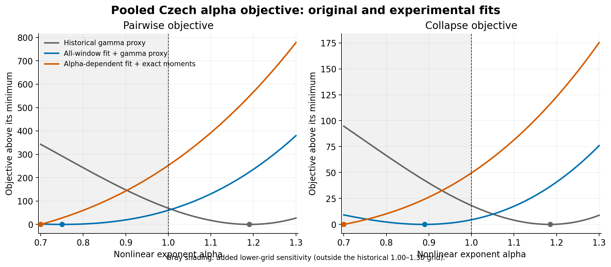

# 1.4 - Historical pooled Czech alpha replay

**Result:** the new machinery does not identify alpha in the original illustrative pooled Czech analysis. The historical optima are reproduced exactly; with improved frailty fitting they shift to the lower search boundary. Exact nonlinear survivor moments do not restore an interior optimum. This is an isolated candidate experiment for lead-author review, not an adopted method, manuscript edit, or additional LLM evaluation.

## Historical analysis and scope

The original source is Git commit `e50c23ca`, including `test/alpha/code/estimate_alpha.py`, its YAML and Czech wave definition. The actual historical CMR workbook was recovered from Git LFS; SHA-256 `aafa9d34f64f56010246e7536099d758821deaf3c4175184bedbe022387d3ad3` was verified before reconstructing aggregate risk sets. The registry contains 12,597,668 data records; that is not a count of distinct eligible persons.

The historical configuration includes birth decades 1930, 1940, 1950 and doses **0-3**. Five of seven configured enrollment dates overlap the wave 2021-41 through 2022-12; 2022_26 and 2022_47 do not. The more recent checked-in configuration selects only doses 0 and 2; its 7.35 million memberships in the earlier shape-only diagnostic must not be mistaken for the original run.

| Historical enrollment | Selected memberships |
|---|---:|
| 2021_13 | 2,097,746 |
| 2021_20 | 2,084,808 |
| 2021_24 | 2,079,480 |
| 2021_30 | 2,071,933 |
| 2022_06 | 2,028,001 |
| Total | 10,361,968 |

These overlapping enrollment snapshots are not independent people. Of 59 cohort histories, 48 meet historical eligibility checks (10,361,791 memberships). Their 948 cohort-week rows contain 174,654 death counts, including repetitions across enrollment snapshots. The old objective keeps positive observed excess relative to dose 0: this leaves **62 cohort-week rows from only eight cohorts**, containing 2,223 death counts. The pairwise objective uses 84 pairs in 17 weeks, and the collapse objective uses 41 points in nine weeks. These counts explain why the full registry size is not a measure of the information in the alpha objective.

## Matched comparisons

- Historical: unmodified original fitting and alpha objectives; reproduces pairwise 1.190 (objective 3974.037464) and collapse 1.185 (1163.667664), including normalized curvature.
- All-window: replace the historical fit by the improved all-window joint gamma-working fit, keeping the mean-one gamma moment proxy.
- Exact: use the nonlinear survivor-law fit with exact weekly exposure reconstruction and replace the gamma proxy by the mean-normalized survivor moment, E[(Z/E[Z|alive])^alpha | alive]. Fit k and theta anew at every candidate alpha, rather than fitting at a fixed 1.18 and treating those inputs as independent. Use the historical week-end timing and pre-skip convention. For alpha=1 the factor equals one.

All three arms preserve the historical observed excess definition, eligibility, reference dose, weighting and pairwise/collapse loss definitions. The empirical objective uses the raw observed hazard difference h_d(t) - h_dose0(t), not known disease-specific excess or excess above a fitted baseline. It does not impose an externally established intervention-effect scale. The manuscript requires such a scale for identification under the proposed cross-cohort approach; this replay tests the illustrative historical objective, not a validated causal estimator or a fully specified external-scale analysis.

## Original search grid: 1.00-1.30 in steps of 0.005

| Fitter / moment | Objective | Alpha minimum | Normalized curvature | Bootstrap stability range (2.5-97.5%) | Boundary fraction | Leave-one-cohort-out range |
|---|---|---:|---:|---|---:|---|
| Historical | Pairwise | 1.190 | 0.000775 | [1.00, 1.30] | 72.4% | [1.00, 1.30] |
| Historical | Collapse | 1.185 | 0.000844 | [1.00, 1.30] | 72.4% | [1.00, 1.30] |
| All-window | Pairwise | 1.000* | N/A | [1.00, 1.30] | 89.7% | [1.00, 1.025] |
| All-window | Collapse | 1.000* | N/A | [1.00, 1.30] | 86.2% | [1.00, 1.155] |
| Exact | Pairwise | 1.000* | N/A | [1.00, 1.30] | 96.6% | [1.00, 1.00] |
| Exact | Collapse | 1.000* | N/A | [1.00, 1.30] | 100% | [1.00, 1.00] |

*Lower search boundary. The historical curvature threshold is 0.01 and the allowed bootstrap boundary fraction is 20%. Every arm fails identification. The historical cohort bootstrap has 29 finite optima out of 30 draws; one is undefined. The empirical percentile ranges above are **stability diagnostics, not valid confidence intervals**: the search is bounded, the draw count is small, and overlapping enrollment cohorts are dependent. Boundary stability cannot establish that alpha=1. The exact fitter succeeded for all 48 eligible cohorts for all 61 grid points; two cohorts were flagged for insufficient signal.

## Wider-grid and flagged-cohort sensitivity

Because the new optima sit at 1, extend the grid diagnostically to 0.70-1.30 in steps of 0.005. This is not the original prespecified grid. Exclude the same two flagged contributing cohorts (2022_06, 1930s dose 1 and 1950s dose 1) from every arm in a separate comparison. These account for 12 of the 62 positive-excess rows. The retained pairwise/collapse objectives then use 44 pairs and 28 points, respectively.

| Fitter / moment | Wider grid: pairwise | Wider grid: collapse | Wider grid without flagged: pairwise | Wider grid without flagged: collapse |
|---|---:|---:|---:|---:|
| Historical | 1.190 | 1.185 | 1.280 | 1.230 |
| All-window | 0.750 | 0.890 | 0.820 | 0.985 |
| Exact | 0.700* | 0.700* | 0.700* | 0.700* |

*Lower search boundary. The original-grid exclusion also leaves both new arms at 1.000. The wider-grid exact branch succeeded across all eligible cohort/candidate combinations; the same two cohorts remained flagged. The working-model interior minima disagree and have low normalized curvature (0.000047 and 0.000107 with all cohorts). No widened-grid arm passes identification. Wider-grid values are diagnostic minima, not estimates with inferential uncertainty.

## Interpretation

Improved fitting changes which alpha minimizes this illustrative loss, not whether alpha is identified. The exact model does not establish alpha=1, alpha=0.7, or a subproportional effect. The original 1.18 remains a configured sensitivity value, not an empirically identified exponent. A separate [temporal-shape Fisher diagnostic](../alpha-information/README.md) also found weak information. Here the historical cross-cohort comparison has actually been replayed, unlike that earlier diagnostic; a fully specified external-scale estimator has not been tested because the historical empirical run did not supply that scale. No additional grid extension or change to KCOR is implied.

## Reproducibility

[Historical aggregate histories](aggregate-histories.csv), [preparation](prepare.py), [matched replay](replay.py), [historical output verification](check_original.py), [diagnostics](diagnostics.py), [original-grid summary](summary.csv), [objective curves](objective-curves.csv), [bootstrap optima](bootstrap.csv), [leave-one-out](leave-one-out.csv), [exact fit diagnostics](exact-fits.csv), [wider grid computation](wider_grid.py), [sensitivity analysis](sensitivity_replay.py), [flag-exclusion results](flag-sensitivity-summary.csv), [wider-grid results](wider-grid-summary.csv), [wider-grid curves](wider-grid-curves.csv), [plot script](plot.py). The saved input is aggregate only. No original source, working manuscript, or production configuration was overwritten.
